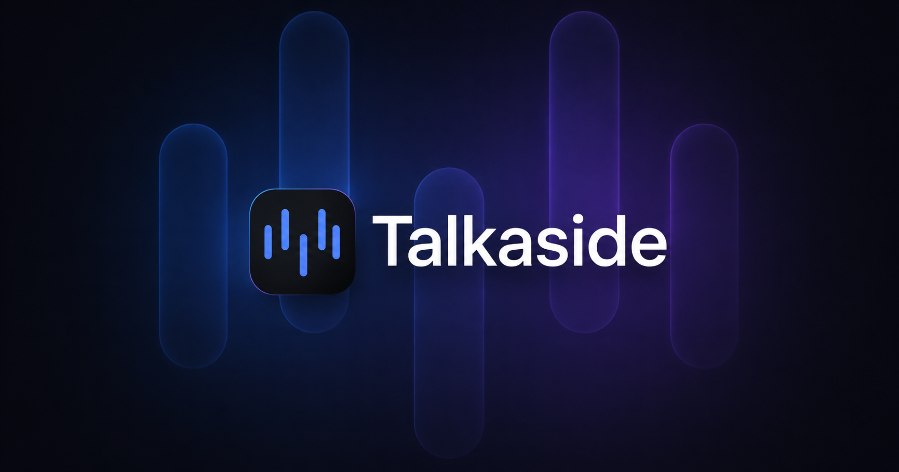

# Talkaside: مساعد المقابلات بالذكاء الاصطناعي وترجمة المكالمات الفورية لنظام Windows

**[talkaside.com](https://talkaside.com/)** · ويندوز 10 و11 · تجربة مجانية لمدة 5 أيام

[English](README.md) · [Русский](README.ru.md) · [Deutsch](README.de.md) · [中文](README.zh.md) · [Español](README.es.md) · [Français](README.fr.md) · [Português](README.pt-BR.md) · [日本語](README.ja.md) · [한국어](README.ko.md) · [العربية](README.ar.md) · [हिन्दी](README.hi.md) · [Türkçe](README.tr.md)

يستمع Talkaside إلى المكالمة الجارية على جهاز الكمبيوتر، ويكتب كلام الطرفين فور قوله، ثم يعطيك أمرين في الوقت الفعلي: اقتراحًا للإجابة عندما يطرح عليك أحدهم سؤالًا، وترجمةً عندما يتحدث الطرف الآخر بلغة لا تفهمها. يعمل مع أي تطبيق مكالمات تستخدمه، لأنه يلتقط الصوت من ويندوز نفسه.

## ما الذي يفعله البرنامج

**اقتراحات الإجابة في المقابلات.** يقرأ مساعدان بالذكاء الاصطناعي النص الحي للمكالمة مع سيرتك الذاتية ووصف الوظيفة وبنك أسئلتك وأجوبتك الخاص، ثم يصوغان إجابة يمكنك قولها بكلماتك. أنت تختار المزودين، وتحتفظ بمفاتيح API الخاصة بك.

**ترجمة حية في الاتجاهين.** تُترجم كل جهة في المكالمة أثناء حديثها، وفي الاتجاهين، لتتابع الحديث وترد باللغة التي تريحك.

**صوتي.** سجّل من 10 إلى 60 ثانية من صوتك، وسيبني Talkaside ملفًا صوتيًا محليًا يُستخدم فقط في كلامك المترجم الذي يُرسل إلى الطرف الآخر. تحتاج هذه الميزة إلى NVIDIA GPU.

**السجل المحلي.** تُحفظ النصوص والجلسات على جهازك في `%LOCALAPPDATA%\Talkaside`. تسجيل المكالمة اختياري، وهو متوقف حتى تشغّله.

**النافذة العائمة.** نافذة صغيرة تبقى فوق النوافذ الأخرى وتعرض الاقتراحات بجانب مكالمتك. صُممت لتبقى خارج لقطات الشاشة المدعومة، حتى لا تظهر ملاحظاتك عندما تشارك شاشتك. تختلف أدوات التقاط الشاشة من برنامج إلى آخر، لذا تحقق منها بأداتك قبل مكالمة مهمة. لا تجعل استخدام المساعد غير قابل للاكتشاف، وليس هذا هدفها.

## الخصوصية

لا يملك Talkaside خادمًا خاصًا به في مسار الصوت. تُرسل الكلام والنصوص إلى مزودي خدمات الكلام والذكاء الاصطناعي الذين تختارهم، ولا تُرسل إلى أي جهة أخرى. يرى هؤلاء المزودون ما ترسله إليهم، لذا اختر كلًّا منهم بعناية.

## المتطلبات والسعر

- ويندوز 10 أو 11، بنظام 64 بت. لا توجد نسخة لأجهزة macOS أو Linux أو الهواتف المحمولة.
- تجربة مجانية لمدة 5 أيام، مع تفعيل واحد لكل جهاز يعمل بنظام ويندوز.
- تتوفر تراخيص مدفوعة لمدة 7 أيام، أو 30 يومًا، أو سنة.
- تُحتسب خدمات الذكاء الاصطناعي والتعرف على الكلام السحابية بشكل منفصل من المزودين الذين تربطهم بالبرنامج.
- المثبّت غير موقّع رقميًا، لذلك قد يعرض Windows SmartScreen تحذيرًا عند أول تشغيل.

## التنزيل

حمّل المثبّت، واقرأ الوثائق، واطلع على الإصدار الحالي على الموقع الرسمي: **[talkaside.com](https://talkaside.com/)**.

---

<a href="https://talkaside.com/">talkaside.com</a>

